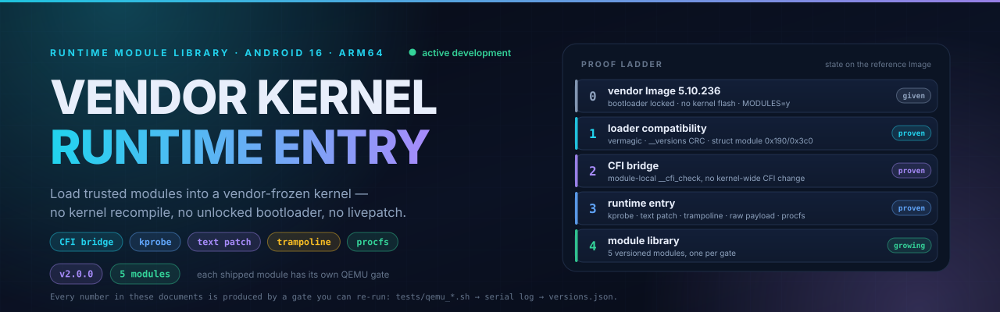
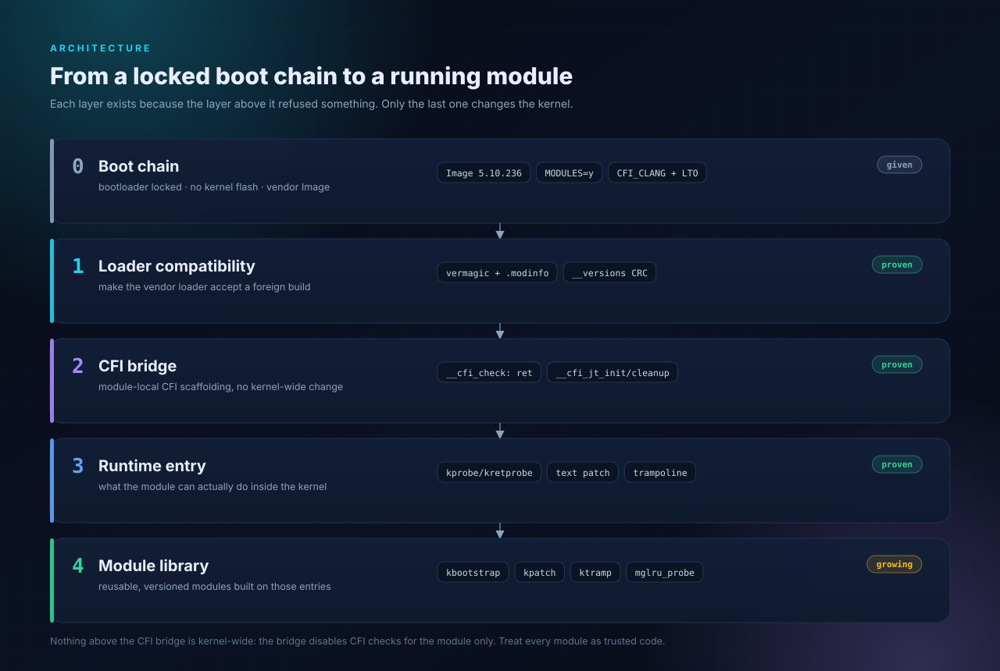
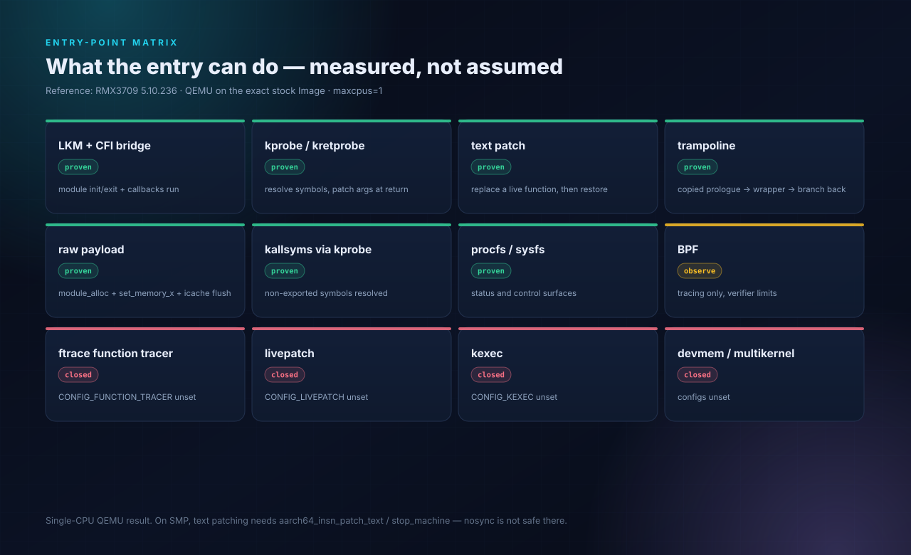
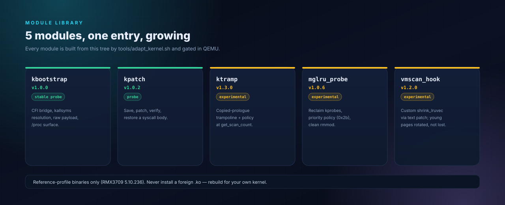
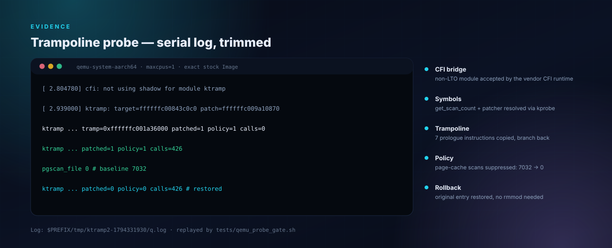
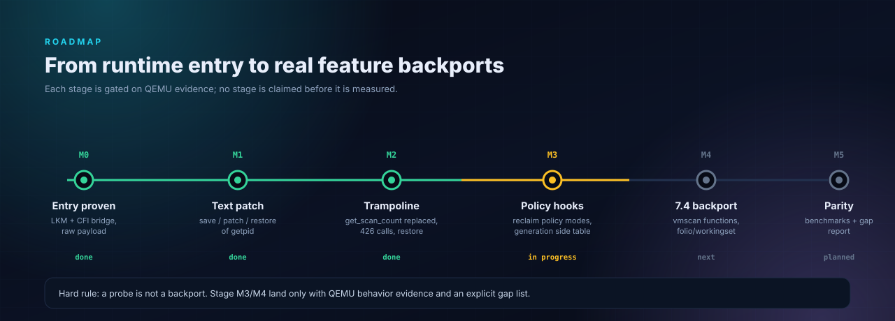

<p align="center">
  
</p>

<p align="center">
  <a href="https://github.com/kosoymiki/vendor-kernel-runtime-entry/releases/latest"></a>
  <a href="https://github.com/kosoymiki/vendor-kernel-runtime-entry/actions/workflows/static.yml"></a>
  
  
  
  
</p>

<p align="center">
  <b>English</b> ·
  <a href="README.ru.md">Русский</a> ·
  <a href="docs/ADAPTING.md">Adapt</a> ·
  <a href="docs/ENTRYPOINTS.md">Entry matrix</a> ·
  <a href="docs/MGLRU.md">MGLRU</a> ·
  <a href="docs/CVE-PATCHING.md">CVE patching</a>
</p>

---

# Vendor Kernel Runtime Entry

> ## 🚧 Active development
>
> **This is a living library, not a frozen snapshot.** The module library, the
> per-target builder and the adaptation methodology are extended **regularly**:
> new backported modules, new entry mechanisms, new target profiles and new
> evidence land as they are proven in QEMU. Interfaces, offsets and module
> packaging may change between minor versions.
>
> Every claim in this repository is tied to a reproducible log. If a stage is
> not measured yet, it is listed as *planned* or *in progress* — never as done.

---

## Table of contents

- [What this is](#what-this-is)
- [Why it works](#why-it-works)
- [Architecture](#architecture)
- [Entry-point matrix](#entry-point-matrix)
- [Module library](#module-library)
- [Quick start](#quick-start)
- [Adapt to your device](#adapt-to-your-device)
- [Evidence](#evidence)
- [Roadmap](#roadmap)
- [Versions](#versions)
- [Documentation](#documentation)
- [Security model and limits](#security-model-and-limits)
- [Repository layout](#repository-layout)
- [Contributing](#contributing)
- [Research ledger](#research-ledger)
- [License](#license)

## What this is

A **runtime entry** for vendor-frozen Android kernels, plus a **growing library
of modules** built on it.

A kernel feature is a compile-time switch. When a vendor ships `CONFIG_KEXEC=n`,
`CONFIG_DEVMEM=n`, no `LIVEPATCH` and no `FUNCTION_TRACER` — and the bootloader
is locked — there is no supported way to add kernel functionality at runtime.
The one door vendors usually leave open is **loadable modules**.

This repository walks through that door, proves what can be done behind it, and
packages the result for **KernelSU / ReSukiSU** on the **Realme GT3 (RMX3709)**
with the vendor kernel `5.10.236-android12-9-o-g27a48ef6c082`
(`CFI_CLANG=y`, `LTO_CLANG=y`, SCS/BTI/PAC, strict W^X).

It is a **reference implementation + per-target builder**, not a universal
binary. The same method is documented step by step so another locked kernel can
be adapted — see [Adapt to your device](#adapt-to-your-device).

## Why it works

Five problems stand between "a `.ko` file" and "code that actually runs":

1. **`vermagic` and `.modinfo`** must match the running kernel exactly.
2. **`__versions` / CRC** — the vendor kernel is built `MODVERSIONS`, so every
   imported symbol needs the real CRC from *its* `Image`, not from a public tree.
3. **`struct module` layout** — `init`/`exit` are relocated against the vendor
   offsets (`0x190` / `0x3c0` on the reference), not against upstream 5.10.
4. **CFI** — `cfi_init()` verifies the module's CFI tables before `init_module`
   is ever called. A clang-21, non-LTO module cannot satisfy a clang-12 LTO
   kernel by accident.
5. **`SHN_XINDEX`** — `ld.lld` emits a symbol table index that the vendor loader
   rejects unless the section-header index is fixed.

The CFI bridge is the interesting part. `__cfi_check` returns immediately,
`__cfi_jt_init_module` / `__cfi_jt_cleanup_module` point at
`bti c; b init_module`, and the `.ref.text`/`.ref.data` layout matches what
`cfi_init()` walks (`kernel/module.c:4530-4545`). The bridge does **not** disable
CFI kernel-wide — it disables the checks **for this module**. The module is
therefore trusted code by construction, and the repository treats it that way.

## Architecture

<p align="center">
  
</p>

Nothing above the bridge is kernel-wide. The loader accepts one foreign module;
the bridge makes that module callable; the entry mechanisms
(kprobe/kretprobe, text patch, trampoline, raw payload, procfs/sysfs) do the
actual work; the module library packages it.

## Entry-point matrix

<p align="center">
  
</p>

| mechanism | needs | state | what it gives |
|---|---|---|---|
| LKM + CFI bridge | `MODULES=y`, unsigned allowed | **proven** | module init/exit and callbacks |
| kprobe / kretprobe | `KPROBES=y` | **proven** | resolve non-exported symbols, modify args |
| text patch | patcher + W^X | **proven (1 CPU QEMU)** | replace a live function, restore |
| trampoline | patcher + `module_alloc` | **proven (1 CPU QEMU)** | replace a whole function body |
| raw payload | `module_alloc`, `set_memory_x` | **proven** | execute trusted AArch64 |
| kallsyms via kprobe | `KPROBES`, kallsyms | **proven** | non-exported symbol resolution |
| procfs / sysfs | `proc_create` | **proven** | status and control surface |
| BPF | `BPF_SYSCALL/EVENTS/JIT` | observe only | tracing, verifier limits |
| ftrace / livepatch / kexec / devmem | their configs | **closed** | absent from the vendor config |

Full detail, including what text patching does *not* prove: [`docs/ENTRYPOINTS.md`](docs/ENTRYPOINTS.md)
([RU](docs/ENTRYPOINTS.ru.md)).

## Module library

<p align="center">
  
</p>

| module | version | status | what it proves | evidence |
|---|---|---|---|---|
| [`kbootstrap`](kernel/) | 1.0.0 | stable probe | CFI bridge, kallsyms resolution, raw payload, `/proc` control | `payload_result=42` · `065f520b…` |
| [`kpatch`](modules/kpatch/) | 1.0.2 | probe | save → `aarch64_insn_patch_text_nosync` → verify → restore of a syscall | `getpid 114 → 0 → 118` · `c4f9a319…` |
| [`ktramp`](modules/ktramp/) | 1.3.0 | experimental | Stage G M5: adaptive ttl 2..4, eviction-age branches 8/9, scan-epoch clock | branch 8 `a80`, branch 9 `a10` 51.1%, `y80` 51.0%, `t5` 100%, `tdist=848` · `e688ddc3…` |
| [`mglru_probe`](modules/mglru/) | 1.0.6 | experimental | reclaim-path kprobes + real `scan_control.priority` policy (0x2b), clean rmmod | `changed=11/11`, `gt0=11`, `pgscan=6071/2464` · `754d20b9…` |
| [`vmscan_hook`](modules/vmscan_hook/) | 1.0.0 | experimental | custom `shrink_lruvec` injected by module text patch; kernel list scanners | `calls=34`, `scans=8209`, `pgscan=8196`, restore/unload · `3fb1610c…` |

The library is the point of the project: each module is built from this tree by
one builder, gated in QEMU, and shipped with its evidence. New backports
(vmscan, workingset, folio paths) are added as they pass their gates.

## Quick start

**Reference target only** (RMX3709 / 5.10.236). A foreign `.ko` will not load,
and forcing it is how devices get bricked.

```sh
# KernelSU / ReSukiSU
ksud module install module.zip
# reboot, then:
cat /proc/kbootstrap
```

Build from source:

```sh
git clone https://github.com/kosoymiki/vendor-kernel-runtime-entry.git
cd vendor-kernel-runtime-entry

# base module
KB_MODULE_SRC=$PWD/kernel KB_MODNAME=kbootstrap \
  tools/adapt_kernel.sh --profile profiles/rmx3709-5.10.236/profile.env

# probes
KB_MODULE_SRC=$PWD/modules/ktramp KB_MODNAME=ktramp \
  tools/adapt_kernel.sh --profile profiles/rmx3709-5.10.236/profile.env
```

Every build runs the ELF/ABI/CRC gates and prints `PASS` per artifact:

```
ktramp.ko   entries=5  imports=4  crc_bad=0  not_exported=0
OK ktramp: this_module=000400 init=0000000000000190 exit=00000000000003c0
sha256 bbfb599a17db566dae1eb664dbafba5de1f5568bd08ac7363ca1ceefc35b55e3
```

## Adapt to your device

Four inputs are required: the target `Image`, its `kallsyms`, one vendor `.ko`
for ABI shape, and the target config. The builder refuses to guess.

```sh
tools/collect_target.sh target/
# fill profiles/my-device/profile.env with the four inputs + offsets
tools/adapt_kernel.sh --profile profiles/my-device/profile.env --qemu
```

The full chain — boot image extraction, kallsyms, CRC generation, `struct
module` offsets, CFI detection, QEMU gate, KernelSU packaging, troubleshooting —
is in [`docs/ADAPTING.md`](docs/ADAPTING.md) ([RU](docs/ADAPTING.ru.md)).
It documents every step with the reasoning behind it, including the failure
modes.

## Evidence

<p align="center">
  
</p>

| artifact | sha256 | gate |
|---|---|---|
| `kbootstrap.ko` | `065f520b1b562f55eef48a138a12d4df3c18d51357bcbacb39b46d1e9a33c593` | `tests/qemu_payload_gate.sh` |
| `kpatch.ko` | `c4f9a319feb6da9d8989bbdb15903bcb6ccce4c361c1fcd1edfc237dfe5ddf11` | `tests/qemu_probe_gate.sh` |
| `ktramp.ko` | `e688ddc30758321a8bc6fb5110529c13af8ee8adc363d70829cef064007fddc2` | `tests/qemu_ktramp_gate.sh` |
| `mglru_probe.ko` | `754d20b990bcd022e8766cbe79676eec847dcdfe50e05f99af660dcddf940ea4` | `tests/qemu_mglru_gate.sh` |
| `vmscan_hook.ko` | `3fb1610cc191b1b5b840aac4140a9c021ac4174d6d5f4eb1f45e5f3c1f7371c9` | `tests/qemu_vmscan_hook_gate.sh` |

Measured on QEMU with the exact stock `Image` (`-smp 1`, `maxcpus=1`):

- **entry:** `cfi: not using shadow for module kbootstrap` →
  `Kernel panic - not syncing: kbootstrap entered` with
  `init_module+0x1c/0xfe8 [kbootstrap]` in the trace — `init_module` really ran.
- **text patch:** `__arm64_sys_getpid` saved, patched to `mov w0,#0; ret`,
  returned `0`, restored, returned `118`.
- **trampoline (Stage G):** `get_scan_count` entry replaced with a branch into
  the module wrapper; scan-epoch clock `seq=123`, `ttl=2`; cold cache takes
  branch 7 (full scan), forced young `y80` branch 6 (51.0%), forced distance
  `t5` branch 1 (100%), forced old/young evictions branches 8/9 (51.1%),
  real refault branch 2 (`tdist=848`); restore and unload clean.
- **custom vmscan:** `vmscan_hook` replaces `shrink_lruvec` with a module
  function that calls the kernel's `shrink_active_list`/`shrink_inactive_list`;
  `calls=34`, `scans=8209`, `pgscan_file=8196`, restore + unload clean.
- **reclaim probes:** baseline `get_scan_count=54`, `pgscan_file=1428`; mode 5
  `get_scan_count=84`, `pgscan_file=4478`, `changed=55/phits=84`
  (`gt0=55`, `zero=84`). Cumulative totals are not comparable across runs — the
  fixed-endpoint `delta/pre` metric is in `ktramp` 1.1.0; see
  [`docs/MGLRU-STAGE-E.md`](docs/MGLRU-STAGE-E.md).
- **payload:** `/proc/kbootstrap` reports `payload_result=42`.

How the reclaim workload is generated (and why `tmpfs` does not work) is
documented in [`docs/MEASURING-RECLAIM.md`](docs/MEASURING-RECLAIM.md).

## Roadmap

<p align="center">
  
</p>

| stage | state | content |
|---|---|---|
| M0 entry | **done** | LKM + CFI bridge + raw payload |
| M1 text patch | **done** | save / patch / verify / restore |
| M2 trampoline | **done** | whole-function replacement |
| M3 policy hooks | **done** | Stage E generation-tier policy, shadow refault distance, SMP-safe patching, restore/unload |
| M4 7.4 backport | **done** | Stage F: per-memcg scan-epoch clock (`seq`/`win`), window-scaled refault threshold, young/cold by epoch |
| M5 parity | **done** | adaptive ttl, eviction-age branches, custom `shrink_lruvec` entry, fidelity gap report |

A probe is not a backport. M3/M4 landed with QEMU behaviour evidence and an
explicit gap list; the 5.10 → 7.4 delta is measured in
[`docs/BACKPORT-7.4.md`](docs/BACKPORT-7.4.md).

## Versions

| tag | what landed |
|---|---|
| [v1.0.0](https://github.com/kosoymiki/vendor-kernel-runtime-entry/releases/tag/v1.0.0) | vendor-ABI LKM, CFI bridge, payload bus, KernelSU package |
| [v1.0.1](https://github.com/kosoymiki/vendor-kernel-runtime-entry/releases/tag/v1.0.1) | bilingual docs, full adaptation and CVE-patching chains |
| [v1.0.2](https://github.com/kosoymiki/vendor-kernel-runtime-entry/releases/tag/v1.0.2) | `kpatch` text-patch probe, `mglru_probe` Stage A/B, entry matrix |
| [v1.0.3](https://github.com/kosoymiki/vendor-kernel-runtime-entry/releases/tag/v1.0.3) | `ktramp` full-function trampoline, real-reclaim gate, SVG infographics, README overhaul |
| [v1.0.4](https://github.com/kosoymiki/vendor-kernel-runtime-entry/releases/tag/v1.0.4) | `mglru_probe` mode 5 priority policy, A/B reclaim gate, measured stage numbers |
| [v1.1.0](https://github.com/kosoymiki/vendor-kernel-runtime-entry/releases/tag/v1.1.0) | MGLRU Stage E: generation-tier young/cold policy, shadow refault distance, `delta/pre` gate, restore/unload, `mglru_probe` 1.0.5 |
| [v1.2.0](https://github.com/kosoymiki/vendor-kernel-runtime-entry/releases/tag/v1.2.0) | MGLRU Stage F (M4 subset): per-memcg scan-epoch clock `seq`/`win`, window-scaled refault threshold, 31/31 unit tests |
| [v1.3.0](https://github.com/kosoymiki/vendor-kernel-runtime-entry/releases/tag/v1.3.0) | MGLRU Stage G (M5): adaptive ttl, eviction-age branches 8/9, `vmscan_hook` custom `shrink_lruvec`, parity report, 38/38 unit tests |
| [v1.4.0](https://github.com/kosoymiki/vendor-kernel-runtime-entry/releases/tag/v1.4.0) | stack gate: `ktramp` policy + `vmscan_hook` custom `shrink_lruvec` compose under real reclaim (`calls=112`, `scans=8579`, `pgscan=8210`), restore/unload clean |

## Documentation

| document | EN | RU | what is inside |
|---|---|---|---|
| Adaptation guide | [ADAPTING](docs/ADAPTING.md) | [ADAPTING.ru](docs/ADAPTING.ru.md) | full user chain, per-step reasoning, troubleshooting |
| Entry matrix | [ENTRYPOINTS](docs/ENTRYPOINTS.md) | [ENTRYPOINTS.ru](docs/ENTRYPOINTS.ru.md) | every mechanism with its evidence and its limits |
| Measuring reclaim | [MEASURING-RECLAIM](docs/MEASURING-RECLAIM.md) | — | how to make QEMU actually scan the file LRU |
| MGLRU probe | [MGLRU](docs/MGLRU.md) | [MGLRU.ru](docs/MGLRU.ru.md) | Stage A/B status, what is *not* parity |
| CVE patching | [CVE-PATCHING](docs/CVE-PATCHING.md) | [CVE-PATCHING.ru](docs/CVE-PATCHING.ru.md) | defensive runtime mitigation template |
| Methodology | [METHODOLOGY](docs/METHODOLOGY.md) | — | how a target is analysed and what is gated |
| Security | [SECURITY](docs/SECURITY.md) | — | threat model, trust boundary, failure modes |
| 7.4 backport map | [BACKPORT-7.4](docs/BACKPORT-7.4.md) | — | measured delta, syscalls, feature order |
| Release procedure | [RELEASE](docs/RELEASE.md) | — | version bump across languages, docs and graphics |

## Security model and limits

This is **arbitrary kernel code execution**. A wrong module can panic, corrupt
memory or brick the device. The repository is built around that fact:

- **QEMU first.** Every module is gated against the exact stock `Image` before
  anyone is told it works.
- **No `rmmod` before restore.** A module that patched text must restore it, and
  the restore must be observed, before unload is even discussed.
- **`nosync` is single-CPU only.** `aarch64_insn_patch_text_nosync` does not stop
  other CPUs. On SMP use `aarch64_insn_patch_text`/`stop_machine` and verify
  under load.
- **The CFI bridge is module-local.** CFI checks are disabled for the module, not
  for the kernel. Module code is trusted code; sign and review it accordingly.
- **No universal binary.** Profiles are per target; a mismatched `.ko` is
  rejected by design.

Read [`docs/SECURITY.md`](docs/SECURITY.md) before loading anything on a device.

## Repository layout

```
assets/      generated SVG infographics (banner, architecture, matrix, roadmap, evidence)
kernel/      base module source + CFI bridge
modules/     kpatch (text patch), ktramp (trampoline), mglru (Stage A/B probe)
module/      KernelSU / ReSukiSU package
tools/       per-target builder, ELF/ABI/CRC gates, delta + asset tooling
profiles/    target profiles (reference: RMX3709 5.10.236)
tests/       static checks, QEMU gates, freestanding reclaim helper
docs/        adaptation, entry matrix, reclaim, MGLRU, CVE, methodology, security
```

The infographics are generated, not hand-drawn: `python3 tools/make_assets.py`
rewrites all six SVGs deterministically and validates XML and geometry. Change
the generator, not the asset.

## Contributing

- Keep evidence with the change: a module without a QEMU gate is not merged.
- One logical change per commit; docs and code travel together.
- New targets go into `profiles/<device>-<kernel>/profile.env` with the inputs
  and offsets that were actually observed — no guesses.
- Probes must say what they are: `probe`, `experimental` or `stable probe`.
  "Backported" is reserved for parity that has been measured.
- Run `python3 tools/check_versions.py && bash tests/static_checks.sh` before
  opening a pull request. A version bump that skips a language, a table or a
  generated asset fails that gate by design — see
  [`docs/RELEASE.md`](docs/RELEASE.md).

## Research ledger

README and documentation structure were informed by primary sources, accessed
2026-11-10 via a headless browser (stealth-browser MCP):

| source | used for |
|---|---|
| [GitHub Docs — About the repository README file](https://docs.github.com/en/repositories/managing-your-repositorys-settings-and-features/customizing-your-repository/about-readmes) | what a README is expected to contain |
| [GitHub Docs — basic writing and formatting](https://docs.github.com/en/get-started/writing-on-github/getting-started-with-writing-and-formatting-on-github/basic-writing-and-formatting-syntax) | Markdown, images, HTML blocks |
| [Best-README-Template](https://github.com/othneildrew/Best-README-Template) | section order, TOC, badge row |
| [awesome-readme](https://github.com/matiassingers/awesome-readme) | evaluation criteria (banner, badges, TOC, screenshots, install steps) |
| [shields.io](https://shields.io/) | static and dynamic badge syntax |
| [Mermaid docs](https://mermaid.js.org/syntax/flowchart.html) | diagram conventions (SVG used instead, for offline determinism) |

## License

GPL-2.0-only. Kernel modules must be GPL-compatible.
