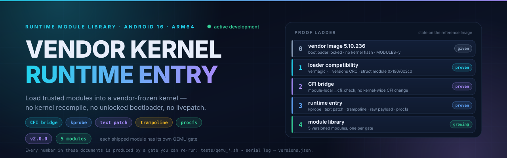
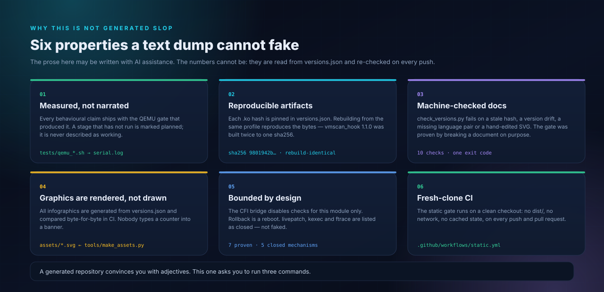
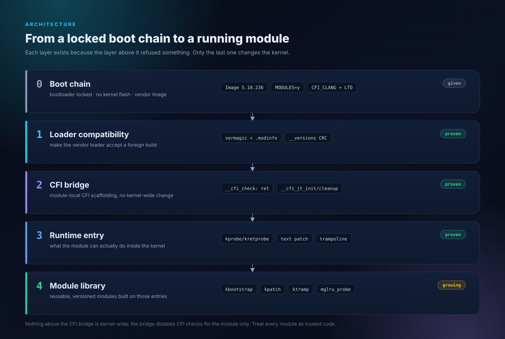
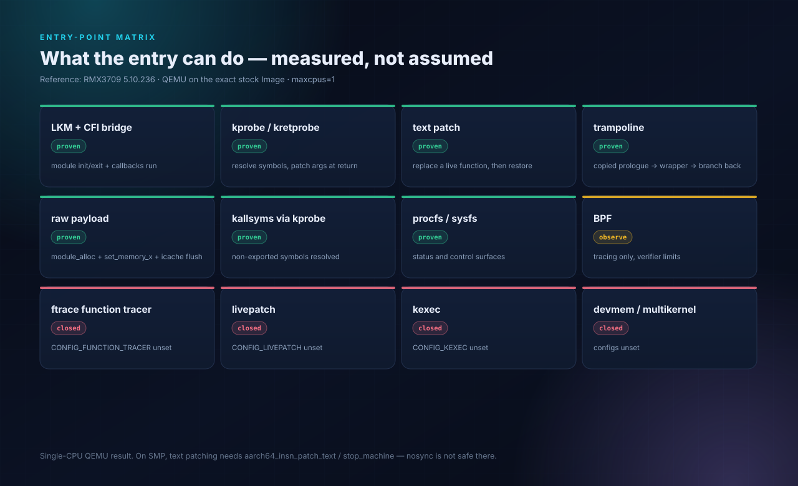
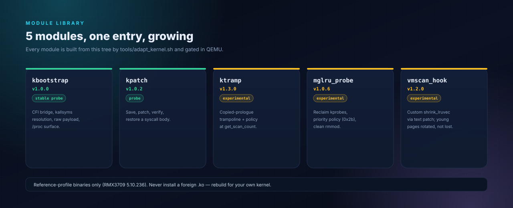
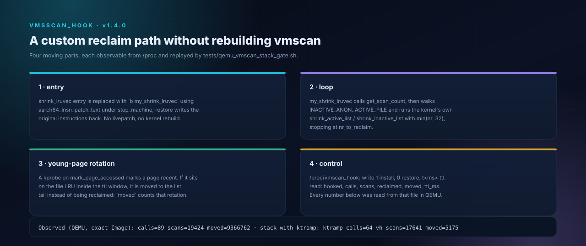
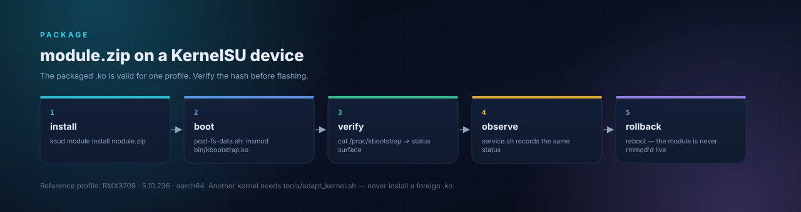
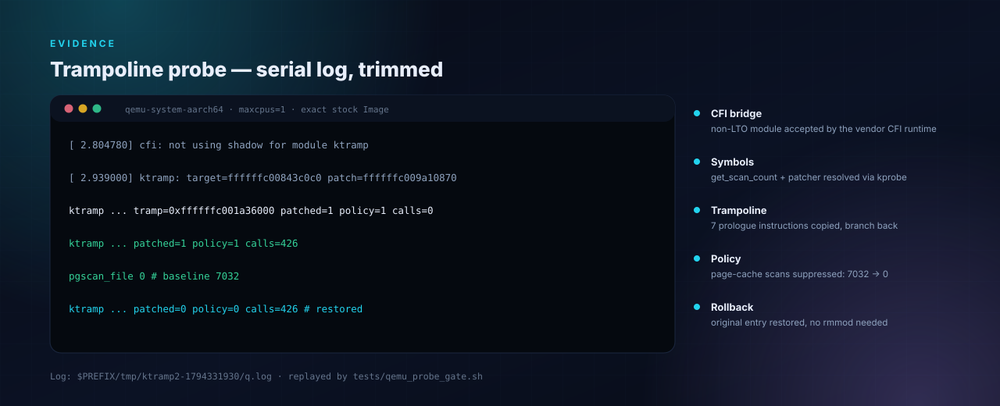
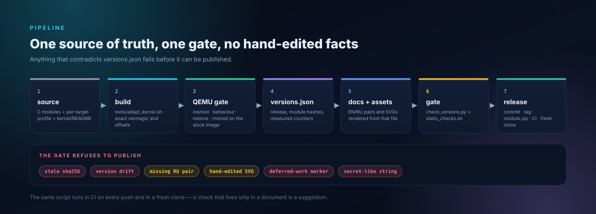
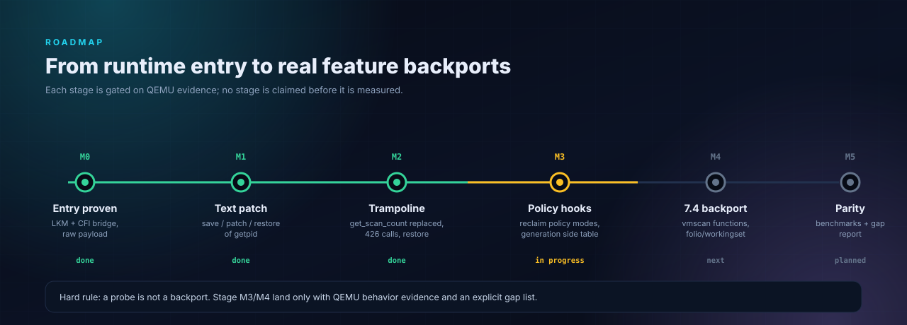

<p align="center">
  
</p>

<p align="center">
  <a href="https://github.com/kosoymiki/vendor-kernel-runtime-entry/releases/latest"></a>
  <a href="https://github.com/kosoymiki/vendor-kernel-runtime-entry/actions/workflows/static.yml"></a>
  
  
  
  
</p>

<p align="center">
  <a href="README.md">English</a> ·
  <b>Русский</b> ·
  <a href="docs/ADAPTING.ru.md">Адаптация</a> ·
  <a href="docs/ENTRYPOINTS.ru.md">Матрица входа</a> ·
  <a href="docs/MGLRU.ru.md">MGLRU</a> ·
  <a href="docs/CVE-PATCHING.ru.md">CVE-патчи</a>
</p>

---

# Runtime Entry для вендорского ядра Linux

## Почему это не нейрослоп

<p align="center">
  
</p>

Текст в этом репозитории может быть написан с помощью ИИ. Числа — нет: каждая
версия, каждый хеш, каждый счётчик и каждая схема читаются из
[`versions.json`](versions.json) генератором и перепроверяются на каждом пуше.

- **Ничего не утверждается без лога.** Каждый модуль поставляется с QEMU-гейтом,
  который произвёл его числа; неизмеренная стадия помечена как *planned* и
  никогда — как «сделано».
- **Хеши воспроизводимы.** `vmscan_hook.ko` 1.2.0 собран дважды из одного
  профиля и дал один sha256 — пин в `versions.json` это и есть та байтовая
  строка, а не копия скроллбека терминала.
- **Документация под машинной проверкой.** `tools/check_versions.py` падает на
  устаревшем хеше, расхождении версий, отсутствующей RU/EN-паре, правленном
  руками SVG, маркере отложенной работы и устаревшем `module.prop` в пакете.
- **Графика рендерится.** Все десять SVG выходят из `tools/make_assets.py`;
  гейт сравнивает перегенерированные байты и не принимает рисунок руками.
- **Область применения ограничена и описана.** CFI-мост отключает проверки для
  одного модуля, откат — это перезагрузка, а ftrace/livepatch/kexec перечислены
  как **закрытые**, а не подделаны.
- **Чистый клон проходит тот же гейт.** `.github/workflows/static.yml` гоняет
  статический гейт без `dist/`, без сети и без кэша.

Если какой-то абзац написала вспомогательная модель, этот абзац всё равно прошёл
через гейт. Запустите `python3 tools/check_versions.py && bash tests/static_checks.sh`
и проверьте сами.

> ## 🚧 Активная разработка
>
> **Это живая библиотека, а не замороженный снимок.** Библиотека модулей,
> per-target builder и методика адаптации пополняются **регулярно**: новые
> бэкпортированные модули, новые механизмы входа, новые профили устройств и
> новые evidence появляются по мере того, как проходят QEMU-гейты. Интерфейсы,
> оффсеты и упаковка модулей могут меняться между минорными версиями.
>
> Каждое утверждение в репозитории привязано к воспроизводимому логу. Если
> стадия ещё не измерена — она помечена как *planned* или *in progress*, но
> никогда как «сделано».

---

## Содержание

- [Что это](#что-это)
- [Почему это не нейрослоп](#почему-это-не-нейрослоп)
- [Почему это работает](#почему-это-работает)
- [Архитектура](#архитектура)
- [Матрица точек входа](#матрица-точек-входа)
- [Библиотека модулей](#библиотека-модулей)
- [Быстрый старт](#быстрый-старт)
- [Адаптация под своё устройство](#адаптация-под-своё-устройство)
- [Evidence](#evidence)
- [Пайплайн релиза](#пайплайн-релиза)
- [Дорожная карта](#дорожная-карта)
- [Версии](#версии)
- [Документация](#документация)
- [Модель безопасности и границы](#модель-безопасности-и-границы)
- [Структура репозитория](#структура-репозитория)
- [Участие](#участие)
- [Источники ресерча](#источники-ресерча)
- [Лицензия](#лицензия)

## Что это

**Runtime-вход** для замороженных вендорских ядер Android плюс **растущая
библиотека модулей**, построенных на нём.

Возможность ядра — это compile-time переключатель. Если вендор собрал
`CONFIG_KEXEC=n`, `CONFIG_DEVMEM=n`, без `LIVEPATCH` и `FUNCTION_TRACER`, а
загрузчик заблокирован — штатного способа добавить функциональность ядра в
рантайме нет. Единственная дверь, которую вендоры обычно оставляют открытой —
**загружаемые модули**.

Репозиторий проходит через эту дверь, доказывает, что за ней можно делать, и
упаковывает результат для **KernelSU / ReSukiSU** на **Realme GT3 (RMX3709)** с
вендорским ядром `5.10.236-android12-9-o-g27a48ef6c082`
(`CFI_CLANG=y`, `LTO_CLANG=y`, SCS/BTI/PAC, strict W^X).

Это **референсная реализация + per-target builder**, а не универсальный бинарь.
Метод описан пошагово, чтобы под него можно было адаптировать другое
заблокированное ядро — см. [Адаптация](#адаптация-под-своё-устройство).

## Почему это работает

Между «файлом `.ko`» и «кодом, который реально исполняется» стоят пять проблем:

1. **`vermagic` и `.modinfo`** должны точно совпадать с работающим ядром.
2. **`__versions` / CRC** — вендорское ядро собрано с `MODVERSIONS`, поэтому
   каждому импортируемому символу нужен реальный CRC из *его* `Image`, а не из
   публичного дерева.
3. **Раскладка `struct module`** — `init`/`exit` релоцируются по вендорским
   оффсетам (`0x190` / `0x3c0` на референсе), а не по upstream 5.10.
4. **CFI** — `cfi_init()` проверяет CFI-таблицы модуля ещё до вызова
   `init_module`. Модуль, собранный clang 21 без LTO, не может случайно
   удовлетворить ядро clang 12 с LTO.
5. **`SHN_XINDEX`** — `ld.lld` выдаёт индекс таблицы символов, который
   вендорский загрузчик не принимает, пока не исправлен индекс в section header.

CFI-мост — самая интересная часть. `__cfi_check` немедленно возвращает,
`__cfi_jt_init_module` / `__cfi_jt_cleanup_module` указывают на
`bti c; b init_module`, а раскладка `.ref.text`/`.ref.data` совпадает с тем, что
обходит `cfi_init()` (`kernel/module.c:4530-4545`). Мост **не** отключает CFI
глобально — он отключает проверки **для этого модуля**. Значит, код модуля по
построению является доверенным, и репозиторий именно так к нему и относится.

## Архитектура

<p align="center">
  
</p>

Ничего выше моста не является kernel-wide. Загрузчик принимает один чужой
модуль; мост делает этот модуль вызываемым; механизмы входа
(kprobe/kretprobe, text patch, трамплин, raw payload, procfs/sysfs) делают
работу; библиотека модулей это упаковывает.

## Матрица точек входа

<p align="center">
  
</p>

| механизм | требует | статус | что даёт |
|---|---|---|---|
| LKM + CFI bridge | `MODULES=y`, unsigned разрешены | **доказано** | init/exit и callbacks модуля |
| kprobe / kretprobe | `KPROBES=y` | **доказано** | резолв неэкспортируемых символов, правка аргументов |
| text patch | патчер + W^X | **доказано (QEMU, 1 CPU)** | замена живой функции + restore |
| трамплин | патчер + `module_alloc` | **доказано (QEMU, 1 CPU)** | замена тела функции целиком |
| raw payload | `module_alloc`, `set_memory_x` | **доказано** | исполнение доверенного AArch64 |
| kallsyms через kprobe | `KPROBES`, kallsyms | **доказано** | резолв неэкспортируемых символов |
| procfs / sysfs | `proc_create` | **доказано** | статус и управление |
| BPF | `BPF_SYSCALL/EVENTS/JIT` | только observe | tracing, ограничения верификатора |
| ftrace / livepatch / kexec / devmem | их конфиги | **закрыто** | отсутствуют в вендорском конфиге |

Подробности, включая то, чего text patch **не** доказывает:
[`docs/ENTRYPOINTS.ru.md`](docs/ENTRYPOINTS.ru.md) ([EN](docs/ENTRYPOINTS.md)).

## Библиотека модулей

<p align="center">
  
</p>

| модуль | версия | статус | что доказывает | evidence |
|---|---|---|---|---|
| [`kbootstrap`](kernel/) | 1.0.0 | stable probe | CFI-мост, резолв kallsyms, raw payload, `/proc` | `payload_result=42` · `065f520b…` |
| [`kpatch`](modules/kpatch/) | 1.0.2 | probe | save → `aarch64_insn_patch_text_nosync` → проверка → restore | `getpid 114 → 0 → 118` · `c4f9a319…` |
| [`ktramp`](modules/ktramp/) | 1.5.0 | экспериментальный | Stage K/L/M: резидентная гистограмма поколений + `min_seq`/window-часы, bloom горячих страниц, ярусный скан поколений, порог `min_ttl` | `res`/`min`/`win`, `bloom=`, `ttlfloor=` live; гейты Stage-K и Stage-L/M · `edf1d550…` |
| [`mglru_probe`](modules/mglru/) | 1.0.6 | экспериментальный | kprobe на reclaim path + реальная политика `scan_control.priority` (0x2b), чистый rmmod | `changed=11/11`, `gt0=11`, `pgscan=6071/2464` · `754d20b9…` |
| [`vmscan_hook`](modules/vmscan_hook/) | 1.4.0 | экспериментальный | кастомный `shrink_lruvec`, четырёхсписковая сортировка, entry-хук `shrink_node_memcgs` (трамплин + priority boost) | `sn_calls=2`, `sn_boost=1`, `pgscan=2144`; sort `moved=9.3M` · `20ec5b71…` |

Смысл проекта — именно библиотека: каждый модуль собирается из этого дерева
одним builder'ом, проходит QEMU-гейт и поставляется вместе со своим evidence.
Новые бэкпорты (vmscan, workingset, folio) добавляются по мере прохождения
гейтов.

<p align="center">
  
</p>

## Быстрый старт

**Только референсная цель** (RMX3709 / 5.10.236). Чужой `.ko` не загрузится, а
попытка его протолкнуть — это способ окирпичить устройство.

```sh
# KernelSU / ReSukiSU
ksud module install module.zip
# reboot, затем:
cat /proc/kbootstrap
```

<p align="center">
  
</p>


Сборка из исходников:

```sh
git clone https://github.com/kosoymiki/vendor-kernel-runtime-entry.git
cd vendor-kernel-runtime-entry

# базовый модуль
KB_MODULE_SRC=$PWD/kernel KB_MODNAME=kbootstrap \
  tools/adapt_kernel.sh --profile profiles/rmx3709-5.10.236/profile.env

# probe-модули
KB_MODULE_SRC=$PWD/modules/ktramp KB_MODNAME=ktramp \
  tools/adapt_kernel.sh --profile profiles/rmx3709-5.10.236/profile.env
```

Каждая сборка прогоняет ELF/ABI/CRC-гейты и печатает `PASS` по артефакту:

```
ktramp.ko   entries=5  imports=4  crc_bad=0  not_exported=0
OK ktramp: this_module=000400 init=0000000000000190 exit=00000000000003c0
sha256 edf1d550520bf540d71ae4271dce051a109789d2f6d00ebcc7e4d7841c82b698
```

## Адаптация под своё устройство

Нужны четыре входа: `Image` цели, её `kallsyms`, один вендорский `.ko` для формы
ABI и конфиг цели. Builder отказывается угадывать.

```sh
tools/collect_target.sh target/
# заполнить profiles/my-device/profile.env: четыре входа + оффсеты
tools/adapt_kernel.sh --profile profiles/my-device/profile.env --qemu
```

Полная цепочка — распаковка boot image, kallsyms, генерация CRC, оффсеты
`struct module`, определение CFI, QEMU-гейт, упаковка KernelSU, разбор ошибок —
в [`docs/ADAPTING.ru.md`](docs/ADAPTING.ru.md) ([EN](docs/ADAPTING.md)).
Каждый шаг описан вместе с причиной и режимами отказа.

## Evidence

<p align="center">
  
</p>

| артефакт | sha256 | гейт |
|---|---|---|
| `kbootstrap.ko` | `065f520b1b562f55eef48a138a12d4df3c18d51357bcbacb39b46d1e9a33c593` | `tests/qemu_payload_gate.sh` |
| `kpatch.ko` | `c4f9a319feb6da9d8989bbdb15903bcb6ccce4c361c1fcd1edfc237dfe5ddf11` | `tests/qemu_probe_gate.sh` |
| `ktramp.ko` | `edf1d550520bf540d71ae4271dce051a109789d2f6d00ebcc7e4d7841c82b698` | `tests/qemu_ktramp_gate.sh` |
| `mglru_probe.ko` | `754d20b990bcd022e8766cbe79676eec847dcdfe50e05f99af660dcddf940ea4` | `tests/qemu_mglru_gate.sh` |
| `vmscan_hook.ko` | `20ec5b71b590f712561a4c4c62e499ebcb06f4453004e7069c3b68e21ce53623` | `tests/qemu_vmscan_hook_gate.sh` |

Измерено в QEMU на точном стоковом `Image` (`-smp 1`, `maxcpus=1`):

- **вход:** `cfi: not using shadow for module kbootstrap` →
  `Kernel panic - not syncing: kbootstrap entered`, в трейсе
  `init_module+0x1c/0xfe8 [kbootstrap]` — `init_module` действительно выполнился.
- **text patch:** первые инструкции `__arm64_sys_getpid` сохранены, записан
  `mov w0,#0; ret`, `getpid` вернул `0`, после restore — `118`.
- **трамплин (Stage G/K/L/M):** вход `get_scan_count` заменён ветвлением в
  обёртку модуля; часы scan-эпох `seq=89`, `ttl=2`; холодный кэш — ветка 7
  (полный скан), форс young `y80` — ветка 6 (51.1%), форс distance `t5` —
  ветка 1 (100%), форс старых/молодых вытеснений — ветки 8/9 (51.7%),
  реальный refault — ветка 2 (`refaults=32`, `dist=849`); резидентные часы
  `res=0,0,0,24430`, `min=86`, `win=3`; bloom горячих страниц `set=24704`,
  `hit=5016`; ярусные ветки 10/11 (`167/2`) и порог `min_ttl`
  (`m60000` → ветка 12, `ttlfloor=647`); restore и unload чистые.
- **кастомный vmscan:** `vmscan_hook` заменяет `shrink_lruvec` функцией модуля,
  которая вызывает штатные `shrink_active_list`/`shrink_inactive_list` и
  ротирует молодые file-страницы в хвост LRU вместо их reclaim:
  `calls=114`, `scans=20589`, `moved=8323`, `ttl_ms=20000`, `pgscan_file=9357`,
  restore + unload чистые. Счётчики ротации — то, что 1.1.0 добавляет к 1.0.0.
- **stack-гейт:** та же нагрузка с загруженной политикой `ktramp`:
  `ktramp calls=64`, `policy_applied=64`, `vmscan_hook scans=17641`,
  `moved=5175`, `sum20=420`, `delta20=198`; оба модуля восстановлены и
  выгружены, поверхности `/proc` исчезли.
- **reclaim-probes:** baseline `get_scan_count=109`, `pgscan_file=6071`; mode 5
  `get_scan_count=11`, `pgscan_file=2464`, `changed=11/phits=11`
  (`gt0=11`, `zero=11`). Накопленные суммы несравнимы между прогонами —
  fixed-endpoint метрика `delta/pre` в `ktramp` 1.1.0; см.
  [`docs/MGLRU-STAGE-E.ru.md`](docs/MGLRU-STAGE-E.ru.md).
- **payload:** `/proc/kbootstrap` отдаёт `payload_result=42`.

Как именно создаётся reclaim-нагрузка (и почему `tmpfs` не работает) —
[`docs/MEASURING-RECLAIM.md`](docs/MEASURING-RECLAIM.md).

## Пайплайн релиза

<p align="center">
  
</p>

Релиз — это всегда одни и те же семь шагов, и гейт, который его проверяет, — тот
же скрипт, что выполняется в CI. Чеклист под схемой: [`docs/RELEASE.md`](docs/RELEASE.md).


## Дорожная карта

<p align="center">
  
</p>

| стадия | состояние | содержание |
|---|---|---|
| M0 вход | **готово** | LKM + CFI-мост + raw payload |
| M1 text patch | **готово** | save / patch / verify / restore |
| M2 трамплин | **готово** | замена функции целиком |
| M3 policy hooks | **готово** | Stage E поколенческая политика, shadow refault distance, SMP-safe патчинг, restore/unload |
| M4 бэкпорт 7.4 | **готово** | Stage F: per-memcg часы scan-эпох (`seq`/`win`), порог refault по окну, young/cold по эпохе |
| M5 parity | **готово** | адаптивный ttl, ветки возраста, вход кастомного `shrink_lruvec`, gap-report точности |
| M6 резидентные часы | **готово** | Stage K: per-memcg 4-bucket резидентная гистограмма поколений, сдвиг старения, часы `min_seq`/`window` |

Probe — это не бэкпорт. M3/M4 закрыты с поведенческим evidence и явным gap-list;
QEMU и явным списком пробелов; дельта 5.10 → 7.4 измерена в
[`docs/BACKPORT-7.4.md`](docs/BACKPORT-7.4.md).

## Версии

| тег | что вошло |
|---|---|
| [v1.0.0](https://github.com/kosoymiki/vendor-kernel-runtime-entry/releases/tag/v1.0.0) | vendor-ABI LKM, CFI-мост, payload bus, пакет KernelSU |
| [v1.0.1](https://github.com/kosoymiki/vendor-kernel-runtime-entry/releases/tag/v1.0.1) | двуязычная документация, полные цепочки адаптации и CVE |
| [v1.0.2](https://github.com/kosoymiki/vendor-kernel-runtime-entry/releases/tag/v1.0.2) | `kpatch` (text patch), `mglru_probe` Stage A/B, матрица входа |
| [v1.0.3](https://github.com/kosoymiki/vendor-kernel-runtime-entry/releases/tag/v1.0.3) | `ktramp` (трамплин), real-reclaim гейт, SVG-инфографика, новый README |
| [v1.0.4](https://github.com/kosoymiki/vendor-kernel-runtime-entry/releases/tag/v1.0.4) | `mglru_probe` mode 5 (политика приоритета), A/B reclaim-гейт, измеренные числа стадии |
| [v1.1.0](https://github.com/kosoymiki/vendor-kernel-runtime-entry/releases/tag/v1.1.0) | MGLRU Stage E: поколенческая young/cold-политика, shadow refault distance, `delta/pre`-гейт, restore/unload, `mglru_probe` 1.0.5 |
| [v1.2.0](https://github.com/kosoymiki/vendor-kernel-runtime-entry/releases/tag/v1.2.0) | MGLRU Stage F (M4 subset): per-memcg часы scan-эпох `seq`/`win`, порог refault по окну, 31/31 unit-тестов |
| [v1.3.0](https://github.com/kosoymiki/vendor-kernel-runtime-entry/releases/tag/v1.3.0) | MGLRU Stage G (M5): адаптивный ttl, ветки возраста 8/9, `vmscan_hook` кастомный `shrink_lruvec`, parity-report, 38/38 unit-тестов |
| [v1.4.0](https://github.com/kosoymiki/vendor-kernel-runtime-entry/releases/tag/v1.4.0) | stack-гейт: политика `ktramp` + кастомный `shrink_lruvec` `vmscan_hook` компонуются под реальным reclaim (`calls=112`, `scans=8579`, `pgscan=8210`), restore/unload чистые |
| [v1.5.0](https://github.com/kosoymiki/vendor-kernel-runtime-entry/releases/tag/v1.5.0) | `vmscan_hook` ротация молодых страниц (`moved=8323`, `ttl_ms=20000`) |
| [v1.6.0](https://github.com/kosoymiki/vendor-kernel-runtime-entry/releases/tag/v1.6.0) | Stage H: поколенческая сортировка inactive-списков (oldest-first), `buckets=5743/865/0/8.9M`, `pgscan=9045` |
| [v1.7.0](https://github.com/kosoymiki/vendor-kernel-runtime-entry/releases/tag/v1.7.0) | Stage I: сортировка всех четырёх evictable-списков, folio head normalization, evidence про runtime-выключенный THP |
| [v1.8.0](https://github.com/kosoymiki/vendor-kernel-runtime-entry/releases/tag/v1.8.0) | Stage J: entry-хук `shrink_node_memcgs` (трамплин с копированием пролога, priority boost), `sn_calls=2`, `pgscan=2144` |
| [v2.0.0](https://github.com/kosoymiki/vendor-kernel-runtime-entry/releases/tag/v2.0.0) | Stage K/L/M: часы поколений (`min_seq`/window), bloom горячих страниц, ярусный скан поколений, порог `min_ttl` — функциональный паритет MGLRU |
| [v1.9.0](https://github.com/kosoymiki/vendor-kernel-runtime-entry/releases/tag/v1.9.0) | Stage K: per-memcg резидентная гистограмма поколений, `min_seq`/window-часы |
| [v1.5.0](https://github.com/kosoymiki/vendor-kernel-runtime-entry/releases/tag/v1.5.0) | `vmscan_hook` 1.1.0: ротация молодых страниц (`moved`, `ttl_ms`), воспроизводимый `.ko`, переработанная шапка, пять новых инфографик, гейт расширен на `module.prop` в `dist/` |

## Документация

| документ | RU | EN | что внутри |
|---|---|---|---|
| Гайд по адаптации | [ADAPTING.ru](docs/ADAPTING.ru.md) | [ADAPTING](docs/ADAPTING.md) | полная цепочка, рефлексия по шагам, разбор ошибок |
| Матрица входа | [ENTRYPOINTS.ru](docs/ENTRYPOINTS.ru.md) | [ENTRYPOINTS](docs/ENTRYPOINTS.md) | каждый механизм с evidence и границами |
| Измерение reclaim | — | [MEASURING-RECLAIM](docs/MEASURING-RECLAIM.md) | как заставить QEMU реально сканировать file LRU |
| MGLRU probe | [MGLRU.ru](docs/MGLRU.ru.md) | [MGLRU](docs/MGLRU.md) | статус Stage A/B, что **не** является parity |
| vmscan hook | [VMSSCAN-HOOK.ru](docs/VMSSCAN-HOOK.ru.md) | [VMSSCAN-HOOK](docs/VMSSCAN-HOOK.md) | кастомный `shrink_lruvec`, политика ротации, счётчики |
| CVE-патчи | [CVE-PATCHING.ru](docs/CVE-PATCHING.ru.md) | [CVE-PATCHING](docs/CVE-PATCHING.md) | шаблон defensive runtime-митигации |
| Методология | — | [METHODOLOGY](docs/METHODOLOGY.md) | как анализируется цель и что гейтится |
| Безопасность | — | [SECURITY](docs/SECURITY.md) | модель угроз, граница доверия, режимы отказа |
| Карта бэкпорта 7.4 | — | [BACKPORT-7.4](docs/BACKPORT-7.4.md) | измеренная дельта, syscalls, порядок фич |
| Процедура релиза | — | [RELEASE](docs/RELEASE.md) | бамп версии по языкам, докам и графике |

## Модель безопасности и границы

Это **произвольное исполнение кода в ядре**. Неверный модуль может вызвать
panic, повредить память или окирпичить устройство. Репозиторий построен вокруг
этого факта:

- **Сначала QEMU.** Каждый модуль проходит гейт на точном стоковом `Image`,
  прежде чем о нём вообще говорят, что он работает.
- **Никакого `rmmod` до restore.** Модуль, пропатчивший текст, обязан вернуть
  оригинал, и restore должен быть наблюдён, прежде чем обсуждать выгрузку.
- **`nosync` — только один CPU.** `aarch64_insn_patch_text_nosync` не
  останавливает другие CPU. На SMP нужен `aarch64_insn_patch_text`/`stop_machine`
  и проверка под нагрузкой.
- **CFI-мост локален для модуля.** Проверки отключены для модуля, не для ядра.
  Код модуля — доверенный; подписывайте и ревьюйте его соответственно.
- **Универсального бинаря нет.** Профили per-target; несовпавший `.ko`
  отбрасывается by design.

Перед загрузкой на устройство прочитайте [`docs/SECURITY.md`](docs/SECURITY.md).

## Структура репозитория

```
assets/      десять сгенерированных SVG (шапка, advantages, pipeline, package, hook, архитектура, матрица, roadmap, evidence, library)
kernel/      исходник базового модуля + CFI-мост
modules/     kpatch (text patch), ktramp (трамплин), mglru (probe Stage A/B)
module/      пакет KernelSU / ReSukiSU
tools/       per-target builder, ELF/ABI/CRC-гейты, delta и генератор ассетов
profiles/    профили целей (референс: RMX3709 5.10.236)
tests/       статические проверки, QEMU-гейты, freestanding helper для reclaim
docs/        адаптация, матрица входа, reclaim, MGLRU, CVE, методология, безопасность
```

Инфографика генерируется, а не рисуется руками: `python3 tools/make_assets.py`
детерминированно пересобирает все десять SVG, валидирует XML и геометрию, а
статический гейт перерендеривает их, чтобы поймать правку руками. Меняйте
генератор, а не ассет.

## Участие

- Держите evidence рядом с изменением: модуль без QEMU-гейта не мержится.
- Один логический change на коммит; документация и код едут вместе.
- Новые цели — в `profiles/<device>-<kernel>/profile.env` с реально
  наблюдёнными входами и оффсетами, без догадок.
- Probe обязан называться probe: `probe`, `experimental` или `stable probe`.
  «Backported» зарезервировано для измеренной parity.
- Перед pull request: `python3 tools/check_versions.py && bash tests/static_checks.sh`.
  Бамп версии, который пропустил язык, таблицу или сгенерированный ассет,
  падает на этом гейте by design — см. [`docs/RELEASE.md`](docs/RELEASE.md).

## Источники ресерча

Структура README и документации опирается на первичные источники, accessed
2026-11-10 через headless browser (stealth-browser MCP):

| источник | для чего использован |
|---|---|
| [GitHub Docs — About the repository README file](https://docs.github.com/en/repositories/managing-your-repositorys-settings-and-features/customizing-your-repository/about-readmes) | что ожидается от README |
| [GitHub Docs — basic writing and formatting](https://docs.github.com/en/get-started/writing-on-github/getting-started-with-writing-and-formatting-on-github/basic-writing-and-formatting-syntax) | Markdown, изображения, HTML-блоки |
| [Best-README-Template](https://github.com/othneildrew/Best-README-Template) | порядок секций, TOC, строка бейджей |
| [awesome-readme](https://github.com/matiassingers/awesome-readme) | критерии оценки (баннер, бейджи, TOC, скриншоты, шаги установки) |
| [shields.io](https://shields.io/) | синтаксис статических и динамических бейджей |
| [Mermaid docs](https://mermaid.js.org/syntax/flowchart.html) | конвенции диаграмм (использован SVG — ради офлайн-детерминизма) |

## Лицензия

GPL-2.0-only. Модули ядра должны быть GPL-совместимыми.
