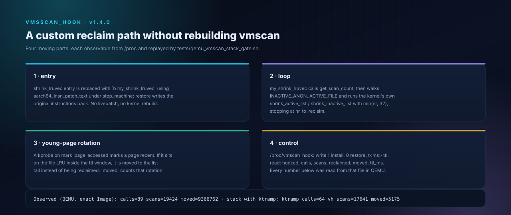

# vmscan_hook — a custom `shrink_lruvec` injected through a module

<p align="center">
  
</p>

This is the entry point for a custom reclaim path without rebuilding vmscan:
the module replaces `shrink_lruvec` with its own function, and that function
runs the kernel's own `shrink_active_list` / `shrink_inactive_list` for the
pages it chooses. Version 1.1.0 adds the part that makes the loop behave like a
generation policy: pages accessed inside a TTL window are rotated to the tail of
their inactive list instead of being reclaimed.

## Why this is possible on 5.10.236

- `CONFIG_KALLSYMS_ALL=y`: `shrink_lruvec`, `get_scan_count`,
  `shrink_active_list`, `shrink_inactive_list` are local symbols but resolvable
  via `kallsyms_lookup_name` (resolved through a temporary kprobe).
- `CONFIG_STRICT_KERNEL_RWX=y`: `aarch64_insn_patch_text` performs the
  stop_machine-safe text update (the same mechanism `kpatch`/`ktramp` use).
- `CONFIG_KPROBES=y`: one kprobe on `mark_page_accessed` records the access time
  that the rotation policy reads; it is registered before the patch and removed
  on restore.
- The vendor CFI runtime is satisfied by the module CFI shim (`__cfi_check`,
  `__cfi_jt_*`), `MODVERSIONS` by the generated `__versions`, and the vendor
  `this_module` layout by the postprocess step.
- No ftrace/livepatch is required (and neither is configured).

## Mechanism

```
shrink_lruvec entry (patched: b my_shrink_lruvec)
        |
        v
my_shrink_lruvec(lruvec, sc)                    [module]
   rotate_young(lruvec)                         [module]
      for page in INACTIVE_ANON / INACTIVE_FILE:
          accessed < ttl_ms ago -> list_move to the list tail
   get_scan_count(lruvec, sc, nr)               [kernel, via kallsyms]
   while nr[]:
       for lru in INACTIVE_ANON..ACTIVE_FILE:
           shrink_active_list(...)              [kernel, via kallsyms]
           shrink_inactive_list(...)            [kernel, via kallsyms]
       stop when sc->nr_reclaimed - r0 >= sc->nr_to_reclaim
```

Access times come from a kprobe on `mark_page_accessed`: the page pointer is
hashed into a fixed 8192-entry table (`(page >> 12) & 8191`) together with
`jiffies`. `rotate_young()` walks the two inactive lists under `pgdat->lru_lock`,
moves every page whose stamp is younger than `ttl_ms` to the tail of its list,
and counts each move in `moved`. The kernel scanner takes from the head, so the
next reclaim pass evicts old generations first — the pages that were just
touched survive one more round.

Offsets used (verified by `scprobe`, see [`OFFSETS.md`](OFFSETS.md)):
`nr_to_reclaim 0x00`, bits `0x28`, `gfp_mask 0x30`, `nr_scanned 0x38`,
`nr_reclaimed 0x40`.

`/proc/vmscan_hook`: write `1` to install, `0` to restore, `t<ms>` to set the
rotation window (default `50` ms). Read back `hooked`, `calls`, `scans`,
`reclaimed`, `moved`, `ttl_ms`.

## Observed in QEMU (stock `Image`, 512 MiB, swapless)

`tests/qemu_vmscan_hook_gate.sh`, v1.6.0 build (built twice from the
same profile, one byte string both times):

```
insmod_rc=0
hook_rc=0
fillmem: mb=345 n=361758720 p=547460788224
poll=18 pgscan=9357
=== COUNTERS ===
vmscan_hook target=-274739253288 hooked=1 calls=114 scans=20589 reclaimed=0 moved=8323 ttl_ms=20000
PASS moved>0
restore_rc=0
vmscan_hook target=-274739253288 hooked=0 calls=114 scans=20589 reclaimed=0 moved=8323 ttl_ms=20000
rmmod_rc=0
proc_gone
module_gone
```

The custom function ran 114 times under real reclaim, scanned 20589 pages with
the kernel's own list scanners, and rotated 8323 young pages to the tail of
their inactive lists with a 20 s window. `pgscan_file=9357` shows the reclaim
path stayed alive. Restore and unload are clean; no panic, and the counters stop
changing after restore — evidence that the patched branch is really gone.

Compared with 1.0.0, the difference is exactly the rotation: 1.0.0 had no
`moved` counter and let the scanner evict whatever sat at the list head,
including pages touched microseconds earlier.

## Composition with `ktramp` (stack gate)

`vmscan_hook` and `ktramp` compose: `my_shrink_lruvec` calls `get_scan_count`,
which is patched by `ktramp`, so the policy-adjusted `nr[]` drives the custom
loop, and the rotation then protects the young pages that policy decided to
keep. `tests/qemu_vmscan_stack_gate.sh` loads both, patches both, and runs real
reclaim:

```
poll=18 pgscan=8205
ktramp target=0xffffffc00843c0c0 tramp=0xffffffc001a8d000 patched=1 policy=1
   calls=64 policy_applied=64 sum20=420 pol20=20 pre20=618 delta20=198 seq=64 ttl=2
vmscan_hook target=-274739253288 hooked=1 calls=64 scans=17641 reclaimed=0 moved=5175 ttl_ms=20000
PASS stack moved>0
vh_off=0 kt_off=0 vh_rm=0 kt_rm=0 vh_gone kt_gone vh_mod_gone kt_mod_gone
```

`policy_applied=64` means every one of the 64 custom-loop calls received a
policy-written scan target; `moved=5175` shows rotation still runs while the
trampoline policy is active. Both modules restore, both unload, both `/proc`
surfaces disappear.

## Stage H — generation-bucket sort of the inactive lists

`rotate_young` now sorts instead of only rotating: under `pgdat->lru_lock` it
walks `LRU_INACTIVE_ANON` and `LRU_INACTIVE_FILE`, buckets every page by age
(`<1 ttl`, `<2 ttl`, `<4 ttl`, `>=4 ttl` / never accessed), and rebuilds each
list oldest-first. The kernel scanner takes from the head, so the oldest
generation is evicted first — MGLRU's ordering on the real lists, without
`lru_gen` structures.

QEMU (`tests/qemu_vmscan_hook_gate.sh`, module sha `20ec5b71…`):

```
poll=18 pgscan=9045
vmscan_hook ... hooked=1 calls=89 scans=19583 moved=8908715
              buckets=5743,865,0,8902107 ttl_ms=20000
restore_rc=0 ... rmmod_rc=0 proc_gone module_gone
```

`moved` is large because the sort runs on every `shrink_lruvec` call; the
bucket split shows the hot pages (5743+865) at the tail and old/never-accessed
pages (8902107) at the head.

## Stage I — sort over all four evictable lists

The sort now covers `LRU_INACTIVE_ANON`, `LRU_ACTIVE_ANON`,
`LRU_INACTIVE_FILE`, `LRU_ACTIVE_FILE`, so old active pages are demoted first
by `shrink_active_list`, and the file/anon inactive heads carry the oldest
generation. QEMU (`sha 20ec5b71…`): `calls=89`, `scans=19424`,
`moved=9366762`, `buckets=14095,2891,1954,9347822`, `pgscan_file=8961`,
restore/unload clean.

Folio note (r2-proven): `enabled_store()` is a four-instruction stub in the
stock Image (`mov x0, x3; ret` at `0xffffffea8bf15874`), so the sysfs THP
switch cannot be changed. The vendor CHP path is closed in the Image too:
`cmdline_parse_prjname` (`0xffffffea8deca55c`) unconditionally clears
`cmdline_cont_pte_sup_prjname`, so `cont_pte_cma_reserve()` never enables
`cont_pte_huge_page_enabled_key` and the `__init` `cont_pte_huge_page_init`
never runs. Entry-point table: static key (initcall dead), early_param
(always false), sysfs (stub), module flag write (no effect), direct
`static_key_slow_inc` (would run an uninitialized pool). Hence no compound/huge
LRU pages on this image (`AnonHugePages=0`, `compound=0`); the module
normalizes compound heads and keeps the folio path ready for a kernel whose
CHP/THP init is enabled, with the normalization unit-tested.

## Stage J — `shrink_node_memcgs` entry hook

A second target: `shrink_node_memcgs` (`0xffffffea8be3abdc`) is patched with a
copied-prologue trampoline (7 instructions, branch back to `target+28`); the
wrapper counts calls and, in boost mode, writes `sc->priority` (`0x2b`) to 0
before calling the original. QEMU (`sha 20ec5b71…`): `sn_hooked=1`,
`sn_calls=2`, `sn_boost=1`, `pgscan_file=2144`; restore `sn_hooked 1→0`,
`rmmod_rc=0`, `proc_gone`, `module_gone`. This is the per-node/memcg scan
interception point; per-memcg policy data comes from the vendor tracepoint.

## Limits (honest)

- The loop is intentionally simplified: it does not replicate vmscan's
  proportional anon/file adjustment, `blk_start_plug`, or the `scan_adjusted`
  heuristic. `reclaimed` in the readback is the last call's delta.
- The generation table is a fixed 8192-entry hash of the page address, not a
  per-page timestamp. Collisions drop a stamp; the rotation is a heuristic, not
  a precise LRU.
- Rotation moves pages within one list only. It does not promote anything to the
  active list, and it does not know about memcg membership beyond the `lruvec`
  it was called with.
- It calls `get_scan_count` for the scan targets; a fully custom generation
  policy can replace that call with module-side computation.
- It replaces `shrink_lruvec` only. `shrink_node_memcgs` still iterates memcgs;
  a custom `shrink_node` is a separate patch target.
- Text patching is a privileged, per-kernel operation: the module refuses to
  patch if the branch is out of range, and `write 0` restores the original
  instruction. QEMU first; reboot is the ultimate rollback.

## Build and gate

```sh
KB_MODULE_SRC=$PWD/modules/vmscan_hook KB_MODNAME=vmscan_hook \
  tools/adapt_kernel.sh --profile profiles/rmx3709-5.10.236/profile.env

KB_IMAGE=$HOME/tmp/kernel_Image.bin \
  KB_KO=$PWD/modules/vmscan_hook/vmscan_hook.ko \
  bash tests/qemu_vmscan_hook_gate.sh

KB_IMAGE=$HOME/tmp/kernel_Image.bin \
  KB_KO=$PWD/modules/vmscan_hook/vmscan_hook.ko \
  KB_KO2=$PWD/modules/ktramp/ktramp.ko \
  bash tests/qemu_vmscan_stack_gate.sh
```
