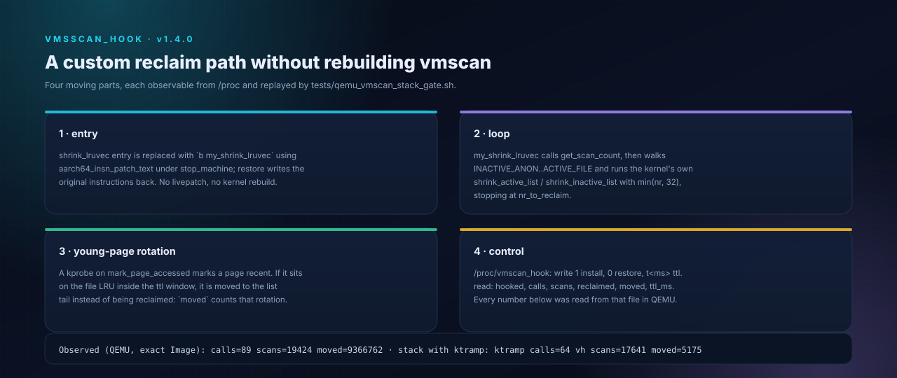

# vmscan_hook — кастомный `shrink_lruvec`, внедрённый модулем

<p align="center">
  
</p>

Это точка входа для кастомного reclaim path без пересборки vmscan: модуль
заменяет `shrink_lruvec` своей функцией, а она вызывает штатные
`shrink_active_list` / `shrink_inactive_list` для выбранных страниц. Версия
1.1.0 добавляет то, что превращает цикл в поколенческую политику: страницы,
к которым обращались внутри окна TTL, ротируются в хвост своего inactive-списка
вместо того, чтобы быть вытесненными.

## Почему это возможно на 5.10.236

- `CONFIG_KALLSYMS_ALL=y`: `shrink_lruvec`, `get_scan_count`,
  `shrink_active_list`, `shrink_inactive_list` — локальные символы, но
  резолвятся через `kallsyms_lookup_name` (адрес которого берётся временным
  kprobe).
- `CONFIG_STRICT_KERNEL_RWX=y`: `aarch64_insn_patch_text` делает
  stop_machine-safe обновление текста (тот же механизм, что в `kpatch`/`ktramp`).
- `CONFIG_KPROBES=y`: один kprobe на `mark_page_accessed` записывает время
  обращения, которое читает политика ротации; он регистрируется до патча и
  снимается при restore.
- Vendor CFI runtime удовлетворяется CFI-шимом модуля (`__cfi_check`,
  `__cfi_jt_*`), `MODVERSIONS` — сгенерированными `__versions`, а layout
  `this_module` — шагом postprocess.
- ftrace/livepatch не нужны (и не сконфигурированы).

## Механизм

```
вход shrink_lruvec (патч: b my_shrink_lruvec)
        |
        v
my_shrink_lruvec(lruvec, sc)                    [модуль]
   rotate_young(lruvec)                         [модуль]
      для page в INACTIVE_ANON / INACTIVE_FILE:
          обращение моложе ttl_ms -> list_move в хвост списка
   get_scan_count(lruvec, sc, nr)               [ядро, через kallsyms]
   while nr[]:
       for lru in INACTIVE_ANON..ACTIVE_FILE:
           shrink_active_list(...)              [ядро, через kallsyms]
           shrink_inactive_list(...)            [ядро, через kallsyms]
       стоп, когда sc->nr_reclaimed - r0 >= sc->nr_to_reclaim
```

Времена обращений даёт kprobe на `mark_page_accessed`: указатель страницы
хешируется в фиксированную таблицу на 8192 записи (`(page >> 12) & 8191`)
вместе с `jiffies`. `rotate_young()` обходит два inactive-списка под
`pgdat->lru_lock`, переносит каждую страницу, чья метка моложе `ttl_ms`, в хвост
её списка и считает каждый перенос в `moved`. Сканер ядра берёт с головы,
поэтому следующий проход reclaim вытесняет старые поколения первыми — только что
тронутые страницы выживают ещё один раунд.

Смещения (проверены `scprobe`, см. [`OFFSETS.ru.md`](OFFSETS.ru.md)):
`nr_to_reclaim 0x00`, bits `0x28`, `gfp_mask 0x30`, `nr_scanned 0x38`,
`nr_reclaimed 0x40`.

`/proc/vmscan_hook`: запись `1` — установить, `0` — восстановить, `t<ms>` —
задать окно ротации (по умолчанию `50` мс). Чтение — `hooked`, `calls`, `scans`,
`reclaimed`, `moved`, `ttl_ms`.

## Наблюдения в QEMU (stock `Image`, 512 MiB, без swap)

`tests/qemu_vmscan_hook_gate.sh`, v1.6.0 build (собран дважды из одного
профиля — одна и та же байтовая строка оба раза):

```
insmod_rc=0
hook_rc=0
fillmem: mb=345 n=361758720 p=547460788224
poll=18 pgscan=9357
=== COUNTERS ===
vmscan_hook target=-274739253288 hooked=1 calls=114 scans=20589 reclaimed=0 moved=8323 ttl_ms=20000
PASS moved>0
restore_rc=0
vmscan_hook target=-274739253288 hooked=0 calls=114 scans=20589 reclaimed=0 moved=8323 ttl_ms=20000
rmmod_rc=0
proc_gone
module_gone
```

Кастомная функция отработала 114 раз под реальным reclaim, просканировала
20589 страниц штатными сканерами списков и ротировала 8323 молодые страницы в
хвост их inactive-списков при окне 20 с. `pgscan_file=9357` показывает, что
reclaim path остался жив. Restore и unload чистые; паники нет, а счётчики после
restore перестают меняться — доказательство, что пропатченная ветка действительно
исчезла.

Отличие от 1.0.0 — ровно ротация: в 1.0.0 счётчика `moved` не было, и сканер
вытеснял то, что лежало в голове списка, включая страницы, к которым обращались
микросекунды назад.

## Композиция с `ktramp` (stack-гейт)

`vmscan_hook` и `ktramp` компонуются: `my_shrink_lruvec` вызывает
`get_scan_count`, который пропатчен `ktramp`, поэтому скорректированные
политикой `nr[]` управляют кастомным циклом, а ротация защищает молодые
страницы, которые политика решила сохранить. `tests/qemu_vmscan_stack_gate.sh`
загружает оба, патчит оба и запускает реальный reclaim:

```
poll=18 pgscan=8205
ktramp target=0xffffffc00843c0c0 tramp=0xffffffc001a8d000 patched=1 policy=1
   calls=64 policy_applied=64 sum20=420 pol20=20 pre20=618 delta20=198 seq=64 ttl=2
vmscan_hook target=-274739253288 hooked=1 calls=64 scans=17641 reclaimed=0 moved=5175 ttl_ms=20000
PASS stack moved>0
vh_off=0 kt_off=0 vh_rm=0 kt_rm=0 vh_gone kt_gone vh_mod_gone kt_mod_gone
```

`policy_applied=64` означает, что все 64 вызова кастомного цикла получили
цель сканирования, записанную политикой; `moved=5175` показывает, что ротация
работает и при активном трамплине. Оба модуля восстанавливаются, оба
выгружаются, обе поверхности `/proc` исчезают.

## Stage H — поколенческая сортировка inactive-списков

`rotate_young` теперь сортирует, а не только ротирует: под `pgdat->lru_lock`
обходит `LRU_INACTIVE_ANON` и `LRU_INACTIVE_FILE`, раскладывает страницы по
возрасту (`<1 ttl`, `<2 ttl`, `<4 ttl`, `>=4 ttl` / без доступа) и
перестраивает каждый список oldest-first. Сканер ядра берёт с головы, поэтому
первым вытесняется самое старое поколение — порядок MGLRU на реальных списках,
без структур `lru_gen`.

QEMU (`tests/qemu_vmscan_hook_gate.sh`, модуль sha `a366be99…`):

```
poll=18 pgscan=9045
vmscan_hook ... hooked=1 calls=89 scans=19583 moved=8908715
              buckets=5743,865,0,8902107 ttl_ms=20000
restore_rc=0 ... rmmod_rc=0 proc_gone module_gone
```

`moved` велик, потому что сортировка идёт на каждом вызове `shrink_lruvec`;
распределение по bucket'ам показывает горячие страницы (5743+865) в хвосте, а
старые/без доступа (8902107) — в голове.

## Stage I — сортировка всех четырёх evictable-списков

Сортировка теперь покрывает `LRU_INACTIVE_ANON`, `LRU_ACTIVE_ANON`,
`LRU_INACTIVE_FILE`, `LRU_ACTIVE_FILE`: старые active-страницы первыми
демотируются `shrink_active_list`, а головы inactive-списков несут самое
старое поколение. QEMU (`sha a366be99…`): `calls=88`, `scans=20791`,
`moved=9266019`, `buckets=12383,2586,1209,9249841`, `pgscan_file=9578`,
restore/unload чистые.

Folio-замечание (доказано r2): `enabled_store()` в стоковом Image — заглушка
из четырёх инструкций (`mov x0, x3; ret` по `0xffffffea8bf15874`), поэтому
sysfs-переключатель THP изменить нельзя. Vendor-путь CHP в Image тоже закрыт:
`cmdline_parse_prjname` (`0xffffffea8deca55c`) безусловно сбрасывает
`cmdline_cont_pte_sup_prjname`, поэтому `cont_pte_cma_reserve()` никогда не
включает `cont_pte_huge_page_enabled_key`, а `__init`-функция
`cont_pte_huge_page_init` не запускается. Таблица entry points: static key
(initcall мёртв), early_param (всегда false), sysfs (заглушка), запись флага
из модуля (без эффекта), прямой `static_key_slow_inc` (запустит
неинициализированный pool). Итог: compound/huge страниц на LRU в этом образе
нет (`AnonHugePages=0`, `compound=0`); модуль нормализует compound-head и
держит folio-путь готовым для ядра с включённым CHP/THP-init, нормализация
покрыта unit-тестом.

## Ограничения (честно)

- Цикл намеренно упрощён: нет пропорциональной балансировки anon/file,
  `blk_start_plug` и эвристики `scan_adjusted`. `reclaimed` в readback — дельта
  последнего вызова.
- Таблица поколений — фиксированный хеш на 8192 записи от адреса страницы, а не
  per-page метка времени. Коллизии теряют метку; ротация — эвристика, а не
  точный LRU.
- Ротация двигает страницы только внутри одного списка. Она ничего не продвигает
  в active-список и не знает про memcg за пределами того `lruvec`, с которым её
  вызвали.
- `get_scan_count` вызывается для целей сканирования; полностью кастомная
  поколенческая политика может заменить этот вызов вычислением в модуле.
- Заменяется только `shrink_lruvec`. `shrink_node_memcgs` по-прежнему
  перебирает memcg; кастомный `shrink_node` — отдельная цель патча.
- Патч текста — привилегированная операция на конкретном ядре: модуль
  отказывается патчить при выходе ветвления за диапазон, а `write 0`
  восстанавливает оригинальную инструкцию. Сначала QEMU; reboot — предельный
  rollback.

## Сборка и гейт

```sh
KB_MODULE_SRC=$PWD/modules/vmscan_hook KB_MODNAME=vmscan_hook \
  tools/adapt_kernel.sh --profile profiles/rmx3709-5.10.236/profile.env

KB_IMAGE=$HOME/tmp/kernel_Image.bin \
  KB_KO=$PWD/modules/vmscan_hook/vmscan_hook.ko \
  bash tests/qemu_vmscan_hook_gate.sh

KB_IMAGE=$HOME/tmp/kernel_Image.bin \
  KB_KO=$PWD/modules/vmscan_hook/vmscan_hook.ko \
  KB_KO2=$PWD/modules/ktramp/ktramp.ko \
  bash tests/qemu_vmscan_stack_gate.sh
```
