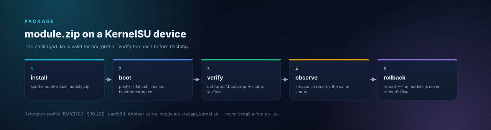

# KernelSU module package

> 🚧 **Active development** — part of a library that grows regularly. New
> modules, stages and target profiles land as they pass their QEMU gates;
> interfaces and evidence are updated together.

<p align="center">
  
</p>

Install `module.zip` with KernelSU/ReSukiSU:

```sh
ksud module install module.zip
# reboot
cat /proc/kbootstrap
```

`post-fs-data.sh` runs `insmod bin/kbootstrap.ko`; `service.sh` records
`/proc/kbootstrap` status. The module is **not** unloaded at runtime:
`rmmod` can panic if the unload/CFI path was not proven; reboot is the safe
rollback.

The packaged `kbootstrap.ko` is only valid for the profile it was built for
(vermagic, `__versions`, struct offsets, CFI mode). For another kernel, rebuild
with `tools/adapt_kernel.sh`; do not install a foreign binary.
