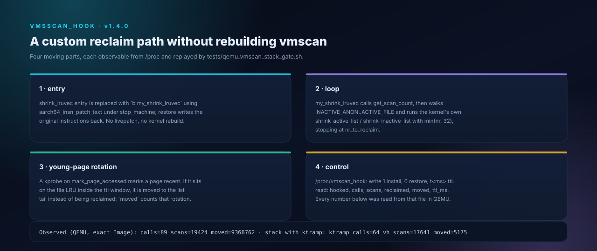

# vmscan_hook — custom `shrink_lruvec` through a module (experimental)

> Part of a library under **active development** — new modules and stages land
> as they pass their QEMU gates.

<p align="center">
  
</p>

Replaces `shrink_lruvec` with a module function and runs the kernel's own
`shrink_active_list` / `shrink_inactive_list` for the pages it chooses. This is
the entry point for a custom reclaim path without rebuilding vmscan. Version
1.1.0 adds a generation policy on top: pages accessed inside a TTL window are
rotated to the tail of their inactive list instead of being evicted.

## Mechanism

- resolve `shrink_lruvec`, `get_scan_count`, `shrink_active_list`,
  `shrink_inactive_list`, `cond_resched` via `kallsyms_lookup_name` (temporary
  kprobe for the resolver itself);
- register one kprobe on `mark_page_accessed`; each hit stores `jiffies` for the
  page in a fixed 8192-entry table keyed by `(page >> 12) & 8191`;
- patch the `shrink_lruvec` entry with `b my_shrink_lruvec` using
  `aarch64_insn_patch_text` (stop_machine);
- `my_shrink_lruvec` first runs `rotate_young()`, which walks the two inactive
  lists under `pgdat->lru_lock` and `list_move()`s every page stamped younger
  than `ttl_ms` to its list tail (counted in `moved`);
- then it calls `get_scan_count`, loops over `INACTIVE_ANON..ACTIVE_FILE`,
  calling the kernel scanners with `min(nr[lru], 32)` and stopping at
  `nr_to_reclaim`;
- `/proc/vmscan_hook`: write `1` install, `0` restore, `t<ms>` set the rotation
  window (default `50` ms); read `hooked`, `calls`, `scans`, `reclaimed`,
  `moved`, `ttl_ms`.

Offsets (verified by `scprobe`): `nr_to_reclaim 0x00`, bits `0x28`,
`gfp_mask 0x30`, `nr_scanned 0x38`, `nr_reclaimed 0x40`; `priority` is `0x2b`
(not `0x2c` — that is `reclaim_idx`). See `docs/OFFSETS.md`.

## Observed (QEMU, stock Image, 512 MiB, swapless)

Gate: `tests/qemu_vmscan_hook_gate.sh`, module 1.1.0, sha256
`9801942be55f90642b26e802bd9e241170340486f72e1e9e35f58ea441f065cd`
(built twice from the same profile; one byte string both times).

```
insmod_rc=0
hook_rc=0
fillmem: mb=345 n=361758720 p=547460788224
poll=18 pgscan=9357
=== COUNTERS ===
vmscan_hook target=-274739253288 hooked=1 calls=114 scans=20589 reclaimed=0 moved=8323 ttl_ms=20000
PASS moved>0
restore_rc=0
vmscan_hook ... hooked=0 calls=114 scans=20589 reclaimed=0 moved=8323 ttl_ms=20000
rmmod_rc=0  proc_gone  module_gone
```

The custom function ran 114 times under real reclaim, scanned 20589 pages with
the kernel's own list scanners, and rotated 8323 young pages to the tail of
their inactive lists with a 20 s window. Counters stop changing after restore —
the patched branch really is gone.

Stack gate (`tests/qemu_vmscan_stack_gate.sh`, `ktramp` policy + this module):

```
ktramp  calls=64 policy_applied=64 sum20=420 pol20=20 pre20=618 delta20=198 seq=64 ttl=2
vmscan  hooked=1 calls=64 scans=17641 reclaimed=0 moved=5175 ttl_ms=20000
vh_off=0 kt_off=0 vh_rm=0 kt_rm=0 vh_gone kt_gone vh_mod_gone kt_mod_gone
```

`policy_applied=64` means every custom-loop call received a policy-written scan
target; `moved=5175` shows rotation still runs while the trampoline is active.

## Limits

The loop is simplified (no proportional anon/file adjustment, no blk plug);
`reclaimed` is the last call's delta. The generation table is a fixed 8192-entry
hash of the page address, so collisions drop a stamp — the rotation is a
heuristic, not an exact LRU. Rotation moves pages inside one list only: nothing
is promoted to the active list, and memcg membership beyond the passed `lruvec`
is not considered. Only `shrink_lruvec` is replaced; a custom `shrink_node` is a
separate patch target. Text patching is privileged: QEMU first, `write 0`
restores, reboot is the ultimate rollback.

## Build

```sh
KB_MODULE_SRC=$PWD/modules/vmscan_hook KB_MODNAME=vmscan_hook \
  tools/adapt_kernel.sh --profile profiles/rmx3709-5.10.236/profile.env
KB_IMAGE=$HOME/tmp/kernel_Image.bin KB_KO=$PWD/modules/vmscan_hook/vmscan_hook.ko \
  bash tests/qemu_vmscan_hook_gate.sh
```
